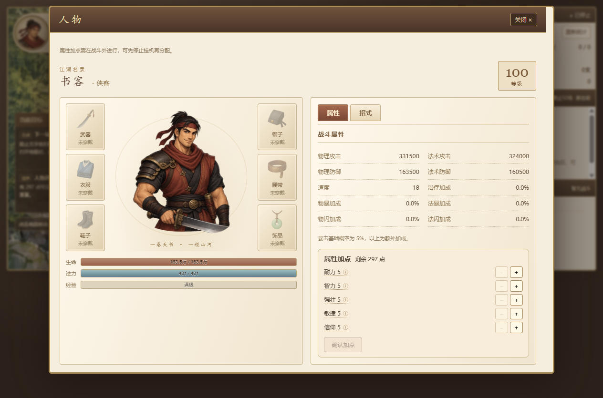

# 山海拾遗

一款可离线游玩的中文挂机刷宝 RPG。带着灵兽巡游山海，在二十个地区收集装备、捕捉宠物，挑战首领并修复天书。

**v1.0.3 · Windows x64 公开测试版。** 本仓库提供玩家文档、截图和下载包；游戏自有源码闭源。

## 玩法

- 从侠客、剑客、符师、修真和药师中选择职业，培养人物技能与属性。
- 点击地图探索，或开启自动巡游刷怪；手动挑战首领，逐步解锁 1–100 级的二十个地区。
- 捕捉、认主和培养灵兽，收集随机装备、宝石与技能书。三个本地槽位分别保存进度。

## 下载与开始游玩

前往 [v1.0.3 下载页](https://github.com/CCJJLL630/shanhai-shiyi/releases/tag/v1.0.3)，下载 **山海拾遗-1.0.3-win-x64.zip**。页面上的 `Source code` 压缩包仅包含本仓库的说明和截图，不能运行游戏。

1. 将 ZIP **完整解压**到普通文件夹。
2. 双击 **山海拾遗.exe**。请保留文件夹内的全部运行文件。
3. 选择职业开始游玩。无需安装 Node.js、npm，无需账户，可离线运行。

F11 切换全屏，Esc 返回窗口。关闭窗口时请等待保存完成。

目标平台为 **Windows x64**。历史运行测试仅覆盖开发机 Windows 11，其他设备和 Windows 版本尚未实测；本版验证情况以发布说明为准。游戏尚未数字签名，Windows 可能提示未知发布者或信誉警告。请核对下载来源和发布页的 SHA-256；若安全软件报警，请保留提示并反馈，不建议关闭安全软件。

## 存档与更新

游戏原名「天书残页」。更名保留 `%APPDATA%\TianShuCanYe` 自动存档目录；手动导出的备份仍默认命名为 `tian-shu-slot-X.json`。请保留原存档目录，新版会继续读取旧进度。

更新前在游戏「存档」页导出 JSON 备份，正常退出后，将新 ZIP 解压到新文件夹。新版本继续读取同一 Windows 用户的原有存档。换电脑或从网页版迁移时，使用 JSON 导出、导入；导入前请备份目标槽位。

## 反馈

请在 [Issues](https://github.com/CCJJLL630/shanhai-shiyi/issues) 提交游戏版本、Windows 版本、复现步骤和截图。提交存档前请检查个人信息。公开测试期间，玩法数值和界面还会调整。

## 许可

Copyright © 2026 CCJJLL630。游戏自有内容采用[个人游玩许可](LICENSE)，允许个人非商业游玩、备份及分享截图、录屏和直播实况。自有源码与素材的其他使用权由作者保留。

第三方组件继续适用各自的 MIT 等许可证，发行包附带相应版权和授权声明。
